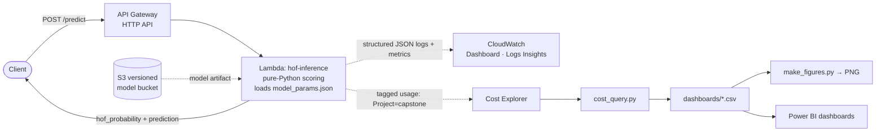
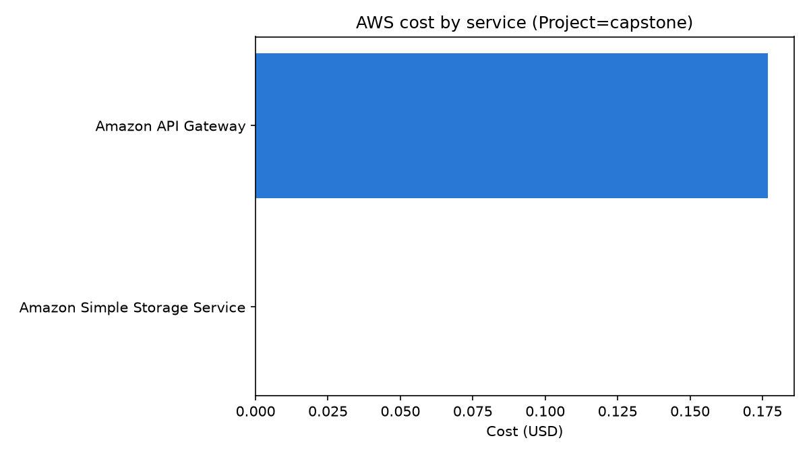
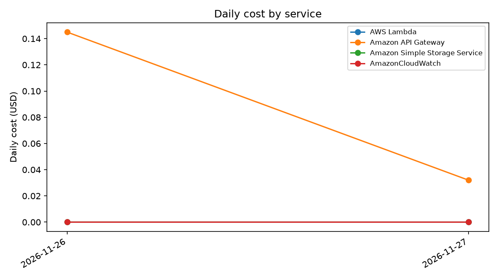
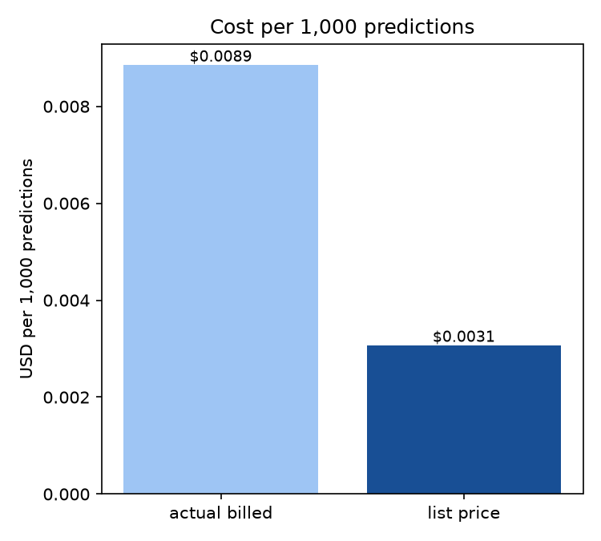

# serverless-ml-finops

[](https://github.com/jasonbland/serverless-ml-finops/actions/workflows/pipeline.yml)
[](https://github.com/jasonbland/serverless-ml-finops/actions/workflows/ci.yml)


A reproducible, **serverless MLOps + FinOps** pipeline on AWS. It serves a machine-learning
model behind a Lambda function and **measures what serving it actually costs** — cost per
1,000 predictions, broken down by service — then instruments the whole thing with
Terraform-defined observability and a self-reporting CI pipeline.

> **Capstone context:** CMIT-590 Information Technology Capstone (Champlain MSIT). The served
> model — a Baseball Hall-of-Fame classifier on the Lahman dataset — is deliberately trivial.
> **The research question is about the *cost and operations* of the serving pipeline, not the
> model's accuracy.** Everything here is designed to be torn down (`terraform destroy`) after
> the data is collected.

---

## Table of Contents

- [What this demonstrates](#what-this-demonstrates)
- [Architecture](#architecture)
- [Repo layout](#repo-layout)
- [Prerequisites](#prerequisites)
- [Quick start](#quick-start)
- [How-to: operate the pipeline](#how-to-operate-the-pipeline)
  - [1. Train the model (local, no AWS)](#1-train-the-model-local-no-aws)
  - [2. Deploy the infrastructure](#2-deploy-the-infrastructure)
  - [3. Invoke the endpoint](#3-invoke-the-endpoint)
  - [4. Run a load test](#4-run-a-load-test)
  - [5. Monitor it (observability)](#5-monitor-it-observability)
  - [6. Measure the cost (FinOps)](#6-measure-the-cost-finops)
  - [7. Generate figures](#7-generate-figures)
  - [8. Tear it down](#8-tear-it-down)
- [CI/CD pipeline](#cicd-pipeline)
- [Results](#results)
- [Troubleshooting](#troubleshooting)
- [Make targets](#make-targets)
- [License](#license)

---

## What this demonstrates

A compact but production-shaped cloud artifact touching the skills a Cloud Engineer is hired for:

- **Serverless architecture** — API Gateway (HTTP API) → Lambda → response, no always-on compute.
- **Infrastructure as Code** — 100% Terraform; the entire stack is `apply`/`destroy`-able and tagged for cost attribution.
- **FinOps** — cost-allocation tagging + Cost Explorer queries → **cost per 1,000 predictions**, per service.
- **Observability** — structured JSON logs, a Terraform-defined CloudWatch dashboard, and saved Logs Insights queries.
- **CI/CD with zero stored secrets** — GitHub Actions authenticates to AWS via **OIDC**; the pipeline load-tests, polls for cost data, builds figures, and reports its own metrics.
- **Testing** — unit tests for the inference handler, including a pure-Python ↔ scikit-learn parity check, gated in CI.

---

## Architecture



**Why pure-Python inference?** The model is a logistic regression (23 baseball features). Training
exports the coefficients + scaler to `model_params.json`; the Lambda scores with
`p = sigmoid(Σ coefᵢ·(xᵢ − meanᵢ)/scaleᵢ + intercept)` using only the Python standard library.
**No scikit-learn, numpy, or joblib at runtime** — so the deployment package is two small files and
needs no Lambda layer. A test verifies the pure-Python path matches scikit-learn to 1e-5.

**Region:** `us-east-2` (Ohio) for all resources. Cost Explorer is a global service, queried via its
`us-east-1` endpoint.

---

## Repo layout

| Path | Purpose |
|------|---------|
| `src/train/` | Lahman data → logistic-regression classifier → `model_params.json` (+ local `model.joblib`) |
| `src/inference/` | Lambda handler — pure-Python scoring + structured JSON logging |
| `terraform/` | IaC: Lambda, API Gateway, S3, IAM, CloudWatch log group + **dashboard**, GitHub OIDC role |
| `scripts/` | `load_test.py` · `cost_query.py` · `make_figures.py` · `metrics_summary.py` |
| `tests/` | `pytest` unit tests for the handler (incl. sklearn-parity) |
| `dashboards/` | Generated cost CSVs + matplotlib PNGs (committed by CI) |
| `.github/workflows/` | `ci.yml` (test gate) · `pipeline.yml` (load/cost/figures/notify) |
| `Makefile` | One-command workflows (see [Make targets](#make-targets)) |

---

## Prerequisites

| Tool | Version | Notes |
|------|---------|-------|
| AWS account | — | with a payment method; Free Tier covers this workload |
| AWS CLI | v2 | `aws configure` → region **`us-east-2`**, output `json` |
| Terraform | ≥ 1.5 | |
| Python | 3.12 (runtime); 3.9+ for local scripts | Lambda runs 3.12 |
| `gh` CLI | any | only for setting repo variables for CI |

**One-time AWS setup** (console, account owner):

1. `aws configure` and verify: `aws sts get-caller-identity` returns your account ID.
2. Billing → **Budgets** → create a **$5** cost budget with an email alert.
3. Billing → **Cost Explorer** → enable (starts populating ~24h later).
4. Billing → **Cost allocation tags** → activate the **`Project`** tag (account-owner-only, ~24h to take effect). *Per-service cost attribution does not work until this is active.*

> ⚠️ **Never commit** AWS keys, account IDs, or `*.tfstate` — all are gitignored.

---

## Quick start

```bash
# 1. Train (local, no AWS) → model_params.json
make train

# 2. Deploy the stack
make deploy

# 3. Grab the endpoint + dashboard URL
terraform -chdir=terraform output api_url
terraform -chdir=terraform output dashboard_url

# 4. Load test → watch the dashboard
make load API_URL="$(terraform -chdir=terraform output -raw api_url)"

# 5. (24–48h later) measure cost + build figures
make cost
make figures
```

---

## How-to: operate the pipeline

### 1. Train the model (local, no AWS)

```bash
make train
# or:
cd src/train && python3 -m venv .venv && ./.venv/bin/pip install -r requirements.txt && ./.venv/bin/python train.py
```

Pulls the Lahman tables via the `pylahman` package, trains a logistic-regression HOF classifier
(23 features: career batting/pitching totals + rate stats + All-Star & award counts), and writes:

- `model_params.json` — the tiny exported model the Lambda loads (committed).
- `model.joblib` — the full scikit-learn pipeline, used only by the local parity test (gitignored).

Prints validation metrics (~0.88 accuracy, ~0.93 ROC-AUC) as a **sanity check** — model quality is not the study object.

### 2. Deploy the infrastructure

```bash
make deploy          # terraform init + apply
```

Creates the Lambda (`hof-inference`), the HTTP API (`POST /predict`), the versioned S3 model bucket,
the CloudWatch log group + **dashboard**, and the GitHub OIDC role. Everything is tagged
`Project=capstone`. Key outputs:

```bash
terraform -chdir=terraform output api_url          # https://<id>.execute-api.us-east-2.amazonaws.com/predict
terraform -chdir=terraform output dashboard_url    # CloudWatch dashboard
terraform -chdir=terraform output github_ci_role_arn
```

### 3. Invoke the endpoint

```bash
API_URL="$(terraform -chdir=terraform output -raw api_url)"
curl -s -X POST "$API_URL" \
  -H 'content-type: application/json' \
  -d '{"features": {"bat_H": 3465, "bat_HR": 260, "bat_RBI": 1311, "bat_AVG": 0.310, "allstar_games": 14, "award_count": 5, "bat_years": 20}}'
# → {"hof_probability": 0.9998, "prediction": 1}
```

The body accepts `{"features": {...}}` or a bare `{...}`. Missing features default to 0. Malformed
input returns `400` with an error message.

### 4. Run a load test

```bash
make load API_URL="$API_URL"                       # default: 20,000 requests, concurrency 20
# or tune:
python3 scripts/load_test.py --url "$API_URL" -n 50000 -c 40
```

A stdlib threaded generator that varies the feature payloads. This is what produces the usage that
later shows up as cost. **Run one at a time** — overlapping runs smear the metrics/cost windows together.

### 5. Monitor it (observability)

Lambda is request-scoped — there is no process to start or stop; idle costs nothing. You watch it four ways:

**The dashboard (one pane — best live view):**

```bash
terraform -chdir=terraform output dashboard_url    # open in a browser
```

CloudWatch → Dashboards → **`capstone-mlfinops`** (region us-east-2). Widgets: Invocations / Errors /
Throttles, Duration p50/p99/avg/max, Concurrent executions, API Gateway count + 4xx/5xx, API latency
p50/p99. Metrics appear at ~1-min granularity — set the time range to cover your load test.

**Structured logs (queryable):** CloudWatch → Logs → **Logs Insights** → log group
`/aws/lambda/hof-inference`. The handler emits one JSON line per request
(`event, request_id, cold_start, latency_ms, prediction, hof_probability, status`), so the fields are
auto-discovered. Three **saved queries** ship with the stack:

- `capstone-mlfinops/latency-percentiles-by-coldstart` — n / avg / p50 / p99, split cold vs warm.
- `capstone-mlfinops/predictions-breakdown` — count by prediction.
- `capstone-mlfinops/recent-errors` — the last 50 errors.

**Console tabs:** Lambda → `hof-inference` → **Monitor**, and API Gateway → `capstone-mlfinops-api` → **Monitoring**.

**In the CI pipeline:** the `load-test` action runs `metrics_summary.py` and writes a metrics table
straight to the **GitHub Actions job summary** — see [CI/CD pipeline](#cicd-pipeline).

### 6. Measure the cost (FinOps)

Billing data lags **24–48h**. After the load test has had time to ingest:

```bash
make cost                                          # or: python3 scripts/cost_query.py --predictions 20000
```

Queries Cost Explorer (filtered to `Project=capstone`), grouped by service + usage type, and writes
`dashboards/cost_over_time.csv`, `cost_by_service.csv`, `unit_cost.csv`. It reports both the **actual
billed** cost and the **list-price cost per 1,000 predictions** — because Free Tier usually zeroes the
real bill, the list-price unit cost is the honest headline (see [ARCHITECTURE.md](ARCHITECTURE.md)).

`--gate` makes it exit `2` until data has landed (used by the CI poller).

### 7. Generate figures

```bash
make figures                                       # matplotlib → dashboards/*.png
```

Reads the CSVs and writes `cost_by_service.png`, `cost_over_time.png`, `unit_cost.png`. For the paper
and video, the same CSVs are also imported into **Power BI** (a manual GUI step — the committed PNGs are
the reproducible-from-code evidence).

### 8. Tear it down

```bash
make destroy                                       # terraform destroy
```

Then disable the daily cron (Actions → ML-FinOps Pipeline → disable) and delete any local AWS access
key you created for the deploy. Serverless means there's nothing left billing between runs, but destroy
anyway once the data is collected.

---

## CI/CD pipeline

Two workflows, both authenticating to AWS via **OIDC — no stored keys**.

**`ci.yml`** — on every push/PR: `pytest` + `terraform fmt -check` + `terraform validate`.

**`pipeline.yml`** — the operational pipeline:

| Trigger | What it does |
|---------|--------------|
| `workflow_dispatch` → `load-test` | runs the load test, then posts a **CloudWatch metrics summary** to the job summary |
| `workflow_dispatch` → `cost-query` | queries Cost Explorer (gated; quiet until data lands) |
| `workflow_dispatch` → `all` | load test → metrics → cost query, back to back |
| `workflow_dispatch` → `figures` | regenerate figures from the current CSVs |
| `schedule` (daily 14:00 UTC) | **polls** for cost data; when it lands, builds + **commits** figures, uploads an artifact, and opens a one-time "✅ cost data ready" issue |

**Setup:** after `terraform apply`, wire the two repo variables the pipeline reads:

```bash
gh variable set API_URL --body "$(terraform -chdir=terraform output -raw api_url)"
gh variable set AWS_ROLE_ARN --body "$(terraform -chdir=terraform output -raw github_ci_role_arn)"
```

The CI role is least-privilege: Cost Explorer read + `cloudwatch:GetMetricData` only.

---

## Results

> **Measured cost data lands 24–48h after the first load test.** This section fills in once Cost
> Explorer ingests the tagged usage; the figures below are committed by the pipeline automatically.

| Metric | Value |
|--------|-------|
| Predictions served | _pending_ |
| Actual billed cost (Free Tier) | _pending — expected ≈ \$0_ |
| **List-price cost per 1,000 predictions** | _pending_ |
| Dominant cost driver | _pending (expected: API Gateway requests)_ |
| p50 / p99 inference latency | _pending_ |

**Lambda memory experiment** (128 / 256 / 512 MB → cost + latency per 1,000): _planned once baseline cost data is in._

<!-- Figures auto-committed by the pipeline:



-->

---

## Troubleshooting

| Symptom | Cause / fix |
|---------|-------------|
| `curl` returns 404 / `Not Found` | Double-slash in the URL (`//predict`). Use the `api_url` output verbatim — single `/predict`. |
| Dashboard / metrics empty | Wrong console **region** — switch to **us-east-2**. Or metrics haven't propagated yet (~1–2 min). |
| Load test: 0 invocations | Bad `API_URL`, or a firewall between you and AWS. Verify `curl` works first. |
| `cost_query.py` returns \$0 / no rows | Expected early: billing lags 24–48h, **and** the `Project` cost-allocation tag must be **activated** (console, ~24h). |
| Cost per-service is blank but total isn't | The `Project` tag isn't active yet — activate it in Billing → Cost allocation tags. |
| CI cost step "not ready" | The `--gate` poller exits 2 until data lands; the daily cron retries. Normal for the first 1–2 days. |
| `terraform` AWS auth error | `aws configure` not set, or wrong region. `aws sts get-caller-identity` to confirm. |

---

## Make targets

```
make train     Train the model → model_params.json
make deploy    terraform init + apply
make load      Generate inference load (API_URL=... PREDICTIONS=N)
make cost      Query Cost Explorer → dashboards/*.csv
make metrics   CloudWatch metrics readout for the last 20 min
make figures   Build matplotlib figures from the CSVs
make test      Run unit tests
make fmt       terraform fmt
make destroy   Tear down all AWS resources
```

---

## License

MIT — see [LICENSE](LICENSE).
